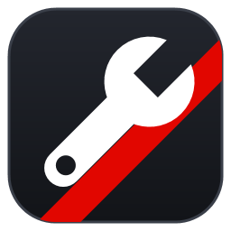
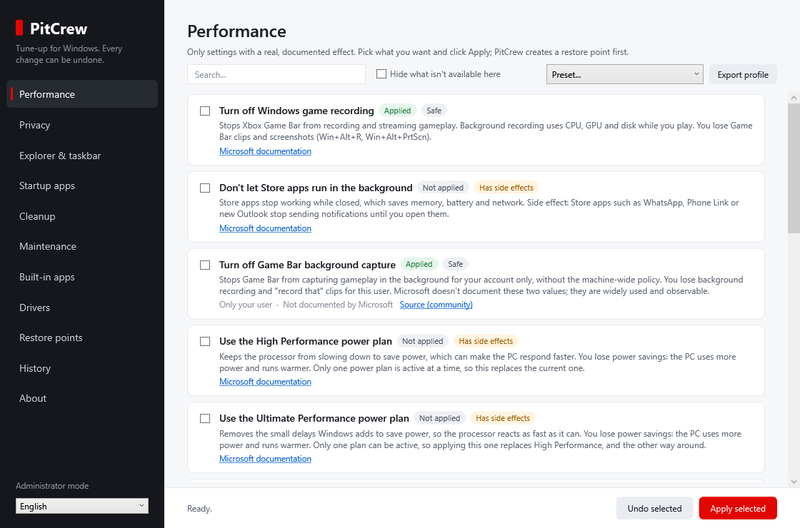

# PitCrew

**Tune-up for Windows 10 and 11. Every change can be undone.**

[Português](README.pt-BR.md)

> **Beta (0.1.1).** PitCrew is still a beta. Keep the restore point box ticked when
> applying, and report anything odd in [Issues](https://github.com/jothank/pitcrew/issues).

PitCrew is a free, open-source maintenance tool for Windows: privacy and performance settings,
disk cleanup, removal of preinstalled apps and driver updates from Windows Update, in one window.



## Principles

- **Only real effects.** Each setting has a documented effect and links to its source, usually
  Microsoft Learn. Popular "tweaks" with no measurable benefit, or that weaken security, are left
  out on purpose: see [docs/NOT-INCLUDED.md](docs/NOT-INCLUDED.md).
- **Everything can be undone.** Before changing a setting, PitCrew records exactly what was there
  (including "this value didn't exist"). Undo puts it back, and leaves alone anything you changed
  yourself afterwards. Before applying, PitCrew offers to create a restore point (ticked by default).
- **Nothing is preselected.** You see the current state of each item and choose what to change.
- **Plain language.** Each item says what it does and what you lose.
- **No telemetry, no ads, no downloads of unknown code.**

## What it does

| Area | What it does |
|---|---|
| Performance | Power plans (desktops), hibernation and Fast Startup, game recording, mouse acceleration, windowed games, GPU scheduling, background apps and more |
| Privacy | Diagnostic data, telemetry service and tasks, ads and suggestions, Copilot, Recall, Widgets, location, Edge/Firefox/Brave data collection and more |
| Explorer & taskbar | File extensions, classic context menu, taskbar alignment and buttons, End Task, dark mode and more |
| Startup apps | Turn programs that open with Windows on or off, the same way Task Manager does |
| Presets and profiles | "Essentials", "Gaming" and "More privacy" only tick boxes for you to review; export what's applied on one PC and import it on another |
| Cleanup | Temp files, Windows Update downloads, Delivery Optimization cache, error reports, crash dumps, Recycle Bin, with sizes shown first |
| Memory | How much RAM is in use and which programs use the most, with a polite way to close them (like clicking X); schedules Windows' own memory test. No "RAM cleaner": see why in [docs/NOT-INCLUDED.md](docs/NOT-INCLUDED.md) |
| Maintenance | Repair system files (DISM + SFC), remove old update files, optimize drives (TRIM on SSDs, defragmentation on hard disks), check drives for errors (read-only), disk health report, clear the DNS cache, back up all drivers |
| Built-in apps | Remove or reinstall 30 preinstalled apps, each labelled "safe" or "read before removing" |
| Drivers | Windows Update drivers, with a check that each one is really newer, a backup of the ones replaced, and a link to your motherboard maker |
| Restore points | See existing points, create one now, open System Restore; before applying, PitCrew offers to create one (checked by default) |
| History | Everything PitCrew changed, with Undo |

Every setting with its source is listed in [docs/CATALOG.md](docs/CATALOG.md) (generated from the
code); what comes next is in [docs/TWEAKS.md](docs/TWEAKS.md).

## Download and run

1. Download the latest `PitCrew-<version>.zip` from [Releases](https://github.com/jothank/pitcrew/releases).
2. Right-click the zip, choose **Extract All...** and then **Extract**.
3. In the folder that opens, open the **PitCrew** folder. Then either:
   - **Install it:** right-click **`Install.bat`** and choose **Run as administrator**. PitCrew
     goes into `C:\Program Files\PitCrew`,
     with a shortcut on the desktop and in the Start menu, and can be removed in Settings > Apps
     like any other program.
   - **Or run it without installing:** double-click **`PitCrew.exe`**. Nothing is installed:
     PitCrew runs from that folder.
4. Windows asks for administrator rights. Answer **Yes** to make changes, or **No** to only look
   around (read-only). Opened from the shortcut, the prompt names Windows PowerShell, which is what
   runs PitCrew's scripts.

To update, do the same with the new zip: `Install.bat` replaces the installed copy and keeps your
undo history. PitCrew can tell you when a new version is out: it asks the first time it opens.

**"Windows protected your PC"?** PitCrew isn't digitally signed yet, so SmartScreen warns about it
like any new program from an unknown publisher. Click **More info**, then **Run anyway**. You can
check the download first: the zip's SHA-256 is published next to it, and `PitCrew.exe` is only a
small launcher whose source is in [`tools/launcher/PitCrew.cs`](tools/launcher/PitCrew.cs).

**Blocked by Smart App Control or your antivirus?** Smart App Control (Windows 11) blocks programs
that aren't signed, with no "run anyway", and also scripts downloaded from the internet when you
double-click them. Right-click **`Install.bat`** and choose **Run as administrator**: it installs
PitCrew, and from then on PitCrew opens normally from its shortcut. Don't turn Smart App Control off
for PitCrew: on many Windows versions it only comes back with a reinstall. A signed release is on the way: see the
[code signing policy](#code-signing-policy).

From PowerShell:

```powershell
.\PitCrew.ps1 -List                              # state of every setting, changes nothing
.\PitCrew.ps1 -Apply privacy.advertising-id      # as administrator
.\PitCrew.ps1 -Undo privacy.advertising-id
```

Logs and the undo journal are kept in `%ProgramData%\PitCrew`.

## Removing PitCrew

First open **History** and undo whatever you want back the way it was: PitCrew can only undo its
changes while its undo journal exists. Then:

- if you installed it, remove **PitCrew** in Settings > Apps > Installed apps (Apps & features on
  Windows 10);
- otherwise, delete the PitCrew folder.

The journal and logs stay in `C:\ProgramData\PitCrew`; delete that folder last, if you want.

## Languages

English, Português (Brasil), Español, Français, Deutsch, Русский, Türkçe and 简体中文. The interface
follows the Windows language (an Argentine Windows gets Spanish, a Portuguese one gets Portuguese)
and falls back to English. A language picked in the window is remembered. The light and dark themes
follow Windows too, or can be picked in the window. Lists can be filtered by state (applied, not
applied, installed...) and every shown item ticked in one click.

Translations other than English and Portuguese were machine-generated. Corrections from native
speakers are very welcome: each language is one file in [`locales/`](locales), and setting texts
live next to each setting in [`tweaks/`](tweaks).

## Testing and building

```powershell
powershell -File tests\Run-Tests.ps1         # no dependencies; touches only a throwaway registry key
powershell -File tools\Start-Sandbox.ps1      # try Apply/Undo for real inside Windows Sandbox
powershell -File tools\Build-Release.ps1      # tests, then dist\PitCrew-<version>.zip from the last commit
powershell -STA -File tools\Build-Icon.ps1    # redraws assets\pitcrew.ico and .png from code
```

The release needs nothing beyond Windows: `PitCrew.exe` is compiled with the C# compiler that
comes with the .NET Framework, and the zip is made by `git archive` from a commit (`-Dev` builds a
test zip from uncommitted changes).

See [docs/ARCHITECTURE.md](docs/ARCHITECTURE.md) for how the engine works and how to add a setting.
Changes per version are in [CHANGELOG.md](CHANGELOG.md); to report a security problem, see
[SECURITY.md](SECURITY.md).

## Support the project

PitCrew is free and always will be. If it helped you, you can support it with any amount via Pix
(Brazil's instant payments): scan the code with your bank app, or use the key below. The same
code is on the About page.


Pix key: `7405c643-a1be-43dc-97f3-ee468160668a`

## Code signing policy

Free code signing provided by [SignPath.io](https://about.signpath.io), certificate by
[SignPath Foundation](https://signpath.org). *Not approved yet: until SignPath Foundation approves
the project, `PitCrew.exe` is unsigned.*

- **What gets signed:** only `PitCrew.exe`, and only when it was built from this repository by
  [GitHub Actions](.github/workflows/build.yml) for a version tag. Every signing request is approved
  by hand. Details are in [docs/SIGNING.md](docs/SIGNING.md).
- **Team:**
  - Committers and reviewers: [Jonathan Costa](https://github.com/jothank).
  - Approvers: [Jonathan Costa](https://github.com/jothank).
- **Privacy:** This program will not transfer any information to other networked systems unless
  specifically requested by the user or the person installing or operating it. PitCrew goes online
  only when you ask it to: searching Windows Update for drivers, reinstalling a built-in app from the
  Microsoft Store, opening a link in your browser, or checking for a new version. The first time it
  opens, PitCrew asks whether it may check (the answer can be changed on the About page). With yes,
  it reads the public list of releases on GitHub when it opens, at most once a day, and sends
  nothing about you or the PC (GitHub sees an ordinary request, like a visit to a web page).

## Author

Made by **Jonathan Costa**, data engineer:
[GitHub](https://github.com/jothank) · [LinkedIn](https://www.linkedin.com/in/jothank/).
PitCrew started as a small script to update my PC's drivers and grew from there.

## License and credits

MIT © 2026 Jonathan Costa. Before writing PitCrew we studied other open-source tools for ideas;
what we took from each and why is in [docs/RESEARCH.md](docs/RESEARCH.md). No code was copied from
GPL projects.
