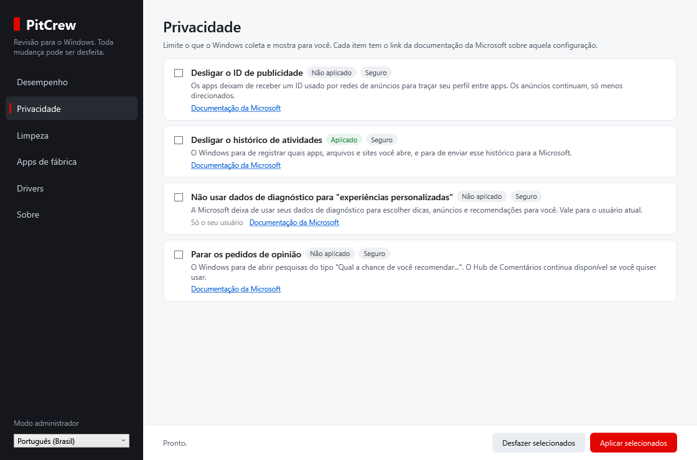

# PitCrew

**Revisão para o Windows 10 e 11. Toda mudança pode ser desfeita.**

[English](README.md)

O PitCrew é uma ferramenta gratuita e de código aberto para cuidar do Windows: ajustes de
privacidade e desempenho, limpeza de disco, remoção de apps de fábrica e atualização de drivers
pelo Windows Update, tudo numa janela só.



## Princípios

- **Só efeito real.** Cada ajuste tem efeito documentado e aponta para a fonte, normalmente o
  Microsoft Learn. "Otimizações" populares que não mudam nada, ou que enfraquecem a segurança,
  ficam de fora de propósito: veja [docs/NOT-INCLUDED.md](docs/NOT-INCLUDED.md).
- **Tudo pode ser desfeito.** Antes de mudar algo, o PitCrew anota exatamente o que havia (inclusive
  "esse valor não existia"). O Desfazer devolve isso e não mexe no que você mesmo mudou depois.
  Um ponto de restauração é criado antes de cada leva de mudanças.
- **Nada vem marcado.** Você vê o estado atual de cada item e escolhe o que mudar.
- **Linguagem simples.** Cada item diz o que faz e o que você perde.
- **Sem telemetria, sem anúncios, sem baixar código desconhecido.**

## O que tem nesta primeira versão

| Área | O que faz |
|---|---|
| Desempenho | Desligar a gravação de jogos; impedir apps da Loja de rodar em segundo plano |
| Privacidade | ID de publicidade, histórico de atividades, experiências personalizadas, pedidos de opinião |
| Limpeza | Temporários (seus e do Windows) e Lixeira, mostrando o tamanho antes de apagar |
| Apps de fábrica | Remover ou reinstalar uma lista escolhida de apps pré-instalados, só do seu usuário |
| Drivers | Atualizações do Windows Update, conferindo se cada uma é mesmo mais nova, com backup dos drivers trocados |

A lista completa planejada está em [docs/TWEAKS.md](docs/TWEAKS.md).

## Como usar

Baixe ou clone o repositório e dê dois cliques em **`PitCrew.bat`**. O Windows pede permissão de
administrador; responda Não para abrir só para ver.

Pelo PowerShell:

```powershell
.\PitCrew.ps1 -List                              # estado de cada ajuste, não muda nada
.\PitCrew.ps1 -Apply privacy.advertising-id      # como administrador
.\PitCrew.ps1 -Undo privacy.advertising-id
```

Logs e o diário de desfazer ficam em `%ProgramData%\PitCrew`.

## Idiomas

Inglês, português (Brasil), espanhol, francês, alemão, russo, turco e chinês simplificado. A janela
segue o idioma do Windows e dá para trocar por ela.

As traduções além de inglês e português foram geradas por máquina. Correções de quem fala esses
idiomas são muito bem-vindas: cada idioma é um arquivo em [`locales/`](locales), e os textos de
cada ajuste ficam junto dele em [`tweaks/`](tweaks).

## Testes

```powershell
powershell -File tests\Run-Tests.ps1     # sem dependências; só mexe numa chave de teste do registro
powershell -File tools\Start-Sandbox.ps1  # testar Aplicar/Desfazer de verdade no Windows Sandbox
```

Veja [docs/ARCHITECTURE.md](docs/ARCHITECTURE.md) para entender o motor e como adicionar um ajuste.

## Licença e créditos

MIT. Antes de escrever o PitCrew estudamos outras ferramentas de código aberto; o que aproveitamos
de cada uma e por quê está em [docs/RESEARCH.md](docs/RESEARCH.md). Nenhum código foi copiado de
projetos GPL.
